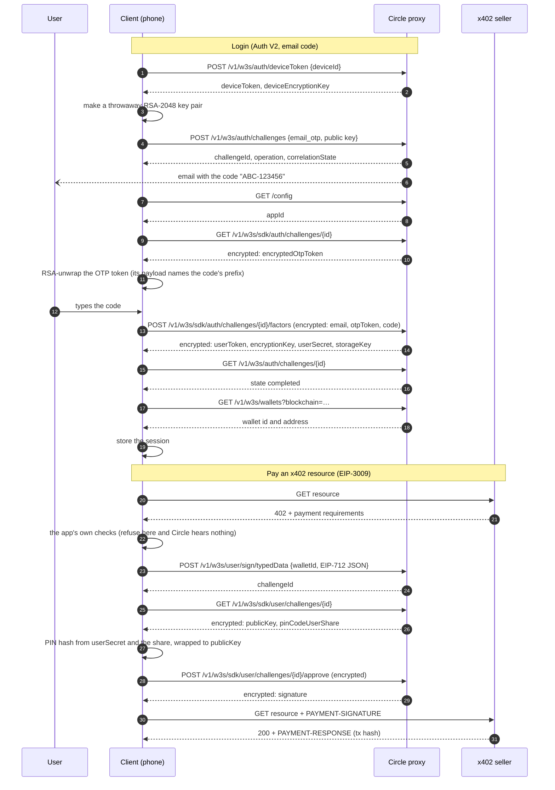

# The protocol

How a client logs in to a Circle Agent Wallet and signs with it, as read from the TypeScript source of `@circle-fin/cli` 1.4.0 (Apache-2.0), which ships inside the npm package in the source map of `dist/index.js`. File references such as `sdk-client.ts:526` point into that source. None of this is documented by Circle for outside use, and any CLI release may change it.

The calls in the tables were read in the CLI's source. Those this library makes were also checked against a stand-in written from the same source (`test/fake-circle.ts`). The login, wallet, balance and typed-data calls ran against Circle from the Nest app on an iPhone on 23 Nov 2026; the contract-call, transaction-status and logout (`local`) calls ran from this package in Node on Arc testnet the same day.

## Where the calls go

Every call goes to a proxy that Circle runs for its CLI: `https://agentic-wallet.circle.com/proxy/test` for testnet and `https://agentic-wallet.circle.com/proxy/live` for mainnet (`config.ts:24,218`). The proxy adds Circle's API key and forwards to Programmable Wallets under `/v1/w3s/…` (`circle-http-client.ts:216`), so the client holds no API key. Testnet and mainnet are separate accounts: a session from one proxy means nothing to the other.

## The whole flow



A contract call follows the same challenge-and-approve steps, starting from `POST /v1/w3s/user/transactions/contractExecution`, and then polls for the result. Logout is one call.

## Two kinds of call

Plain calls (`circle-http-client.ts:266`) send `Content-Type: application/json` and, once there is a token, `X-User-Token: <token>`. They take a JSON body and answer `{data: …}`. The CLI also sends `User-Agent: circle-cli/1.4.0`; this library sends no User-Agent of its own, so the runtime's goes out.

SDK calls (`sdk-client.ts:638`), which are every path under `/v1/w3s/sdk/`, add `X-App-Id`, `X-Device-Id` and `Authorization: Bearer <token>` (the same token as `X-User-Token`). Their body is one bare base64 string: the JSON, encrypted with AES-256-GCM, framed as a 12-byte IV, the ciphertext, then the 16-byte tag. The answer is `{data: {encrypt: "<base64>"}}` in the same framing. The key is `deviceEncryptionKey` during login and the session's `encryptionKey` afterwards.

## Each call

Login. The token in the headers is the device token throughout.

| Step | Call | Sends | Answers | CLI source |
|---|---|---|---|---|
| 1 | `POST /v1/w3s/auth/deviceToken` (no token) | `{idempotencyKey, deviceId}`; `deviceId` is a random UUID the client makes up | `{deviceToken, deviceEncryptionKey}` | `circle-http-client.ts:333`, `auth-flow.ts:305` |
| 2 | `POST /v1/w3s/auth/challenges` | `{idempotencyKey, operation: "login", registeredFactors: [{factor: "email_otp", emailOtp: {destination: <email>, suite: "RSA_OAEP_256_A256GCM", publicKey: <PEM>}}]}` | `{challengeId, operation: "login" \| "bootstrap", state, submissionDeadline, correlationState}`. Circle emails the code. `bootstrap` means the account has no wallets yet | `circle-http-client.ts:499`, `auth-flow.ts:308` |
| 3 | `GET /config` (no token) | nothing | `{appId, passkeyCeremonyOrigin}` | `circle-http-client.ts:224` |
| 4 | `GET /v1/w3s/sdk/auth/challenges/{id}` (SDK) | nothing | decrypts to `{challengeId, operation, state, submissionDeadline, requiredFactors: [{factor: "email_otp", emailOtpParameters: {destinationHint, encryptedOtpToken}}]}` | `sdk-client.ts:300` |
| 5 | local | `encryptedOtpToken` is a DER envelope: five context-tagged fields holding a version `0`, the token under AES-256-GCM, that AES key wrapped with RSA-OAEP (SHA-256, MGF1 SHA-256) to the client's key, and two algorithm identifiers | the `otpToken`, a JWT whose payload carries `otpHead`, the letters before the dash in the emailed code | `crypto.ts:208`, `prompt.ts:25` |
| 6 | `POST /v1/w3s/sdk/auth/challenges/{id}/factors` (SDK) | encrypts `{idempotencyKey, factorSubmissions: [{requiredFactorIndex, emailOtpProof: {destination: <email>, otpToken, code: "ABC-123456"}}]}` | decrypts to `{state: "COMPLETED", userToken, encryptionKey, userSecret, storageKey, refreshToken?, linkToken?}`; 400 or 401 for a wrong or expired code | `sdk-client.ts:338` |
| 7 | `GET /v1/w3s/auth/challenges/{id}`, plus the header `X-Correlation-State` | nothing | `{challengeId, operation, state: "completed", result: {accountRootId}}`. Retried after 0.4, 1.2 and 2.8 s while it is not yet completed or answers 5xx | `circle-http-client.ts:543`, `auth-flow.ts:529` |

The session's expiry is the `exp` claim of the `userToken` JWT (`session.ts:542`). The CLI throws the refresh token away (`auth-flow.ts:232`), and this library never reads it.

On a first login (`bootstrap`) the CLI goes on to `POST /v1/w3s/user/initialize` with `{idempotencyKey, accountType: "SCA", blockchains: […]}`, approves the challenge it returns, and so creates a smart contract account on every chain (`circle-http-client.ts:395`, `auth-flow.ts:264`). This library does the same on testnet, with the CLI's list of nine testnet chains (`chain-map.ts:286`); a 409 means the account is already set up. Unlike the CLI, it treats a creation that fails or times out as an error and keeps no session. On mainnet it stops and asks for one login in the CLI. This path has run against the stand-in only.

With a session. The token in the headers is the user token.

| Call | Sends | Answers | CLI source |
|---|---|---|---|
| `GET /v1/w3s/wallets?pageSize=50&blockchain=ARC-TESTNET` | nothing | `{wallets: [{id, address, blockchain, eoaOwnerAddress, state, …}]}` | `circle-http-client.ts:419` |
| `GET /v1/w3s/wallets/{id}/balances` | optional query `tokenAddress` | `{tokenBalances: [{amount, token: {name, symbol, blockchain, decimals, isNative, tokenAddress}}]}`; `amount` is a decimal string | `circle-http-client.ts:621` |
| `POST /v1/w3s/user/sign/typedData` | `{walletId, data}`, where `data` is a JSON string of `{types (EIP712Domain included), primaryType, domain, message}` with integers as decimal strings. No idempotency key | `{challengeId}` | `circle-http-client.ts:922`, `x402-client.ts:436` |
| `POST /v1/w3s/user/transactions/contractExecution` | `{idempotencyKey, walletId, sourceAddress, blockchain, contractAddress, callData, feeLevel: "MEDIUM"}` | `{challengeId}` | `circle-http-client.ts:854` |
| `GET /v1/w3s/sdk/user/challenges/{id}` (SDK) | nothing | decrypts to `{challengeId, publicKey: <RSA PEM>, pinCodeUserShare, requests, status}` | `sdk-client.ts:275` |
| `POST /v1/w3s/sdk/user/challenges/{id}/approve` (SDK) | encrypts `{idempotencyKey, pinhash, hashPinhash, additionalPinhash: {version: 0, pinhash, hashPinhash}, deviceInfo, pinType: "AUTO"}` | for a signature, decrypts to `{data: {signature}}`; for a transaction there may be no body. 403 means the challenge was already completed | `sdk-client.ts:526`, `x402-client.ts:465`, `commands/wallet/helpers.ts:228` |
| `GET /v1/w3s/user/challenges/{id}` | nothing | `{challenge: {status, correlationIds}}`. Polled until `COMPLETE`, `FAILED` or `EXPIRED`; for a transaction, `correlationIds[0]` is its id | `circle-http-client.ts:591` |
| `GET /v1/w3s/transactions/{id}` | nothing | `{transaction: {state, txHash, errorReason, …}}`. Polled until `CONFIRMED` or `COMPLETE` (done), or `FAILED`, `CANCELLED`, `DENIED` | `circle-http-client.ts:887` |
| `POST /v1/w3s/users/token/deactivate` | `{idempotencyKey, scope: "local" \| "all"}`; `local` ends this session, `all` ends every device's | 204, no body. Afterwards Circle answered that session's balance call with 403 | `circle-http-client.ts:381` |

`deviceInfo` is `{os: {model: "", version: ""}, browser: {model: "WebSDK", version: ""}, device: {model: "Desktop", version: ""}, sdk: {model: "Web", version: ""}}`, the CLI's own value.

## The PIN

Email users never choose a PIN. The client derives one for each challenge (`crypto.ts:387`, `sdk-client.ts:585`):

```
userSecret   = the string Circle returned at login (kept sealed with AES-GCM under storageKey)
pin          = base64( sha256( latin1( userSecret.split(':')[0] + pinCodeUserShare ) ) )
pinhash      = sha256( utf8(pin) )
hashPinhash  = base64( sha256(pinhash) )

legacy       = utf8( UPPERCASE_HEX(pinhash) )                       -- the "additionalPinhash", version 0
legacy hash  = base64( utf8( UPPERCASE_HEX( sha256(legacy) ) ) )
```

Each of `pinhash` and `legacy` is sent base64-encoded and wrapped, with a fresh 32-byte one-time key each time:

```
wrapped = base64( JSON{ pinhash_struct: AES-256-GCM(otkey, JSON{pinhash: <base64>}),
                        otkey:          base64( RSA-OAEP-SHA256(challenge.publicKey, otkey) ) } )
```

The signature Circle returns for the wallet was 65 bytes in the two cases measured, and verifies through the smart account (ERC-1271).

## What the session is

`userToken`, `encryptionKey`, `userSecret` and `storageKey` come from step 6, and `deviceId` and `appId` from steps 1 and 3. Together they are everything needed to sign until the token expires. Nothing in the protocol ties them to a device: the only key the client ever generates is the throwaway RSA pair of step 2, which is discarded after step 5 (`auth-flow.ts:307`). The CLI keeps these values in the macOS Keychain (service `circle-cli`); `userSecret` is stored encrypted under `storageKey`, which sits right beside it, so that encryption adds nothing at rest and the Keychain is the protection.

## Not covered

Three more calls this library makes were read in the CLI's source. Each has run against Circle once, on 24 Nov 2026 (the faucet sent 20 USDC):

| Call | Request | Response | Source |
|---|---|---|---|
| `POST /v1/w3s/user/transactions/transfer` | `{idempotencyKey, walletId, sourceAddress, destinationAddress, amounts: ["0.01"], blockchain, tokenAddress, feeLevel: "MEDIUM"}` | `{challengeId}`, then approved and polled like a contract call | `circle-http-client.ts:808` |
| `POST /fund` (testnet proxy, no `/v1/w3s`) | `{address, blockchain, token: "usdc" \| "eth" \| "eurc" \| "native"}` | unused; the tokens arrive later | `commands/wallet/fund.ts:391` |
| `GET https://api.circle.com/v2/x402/discovery/resources?query=&category=&limit=&offset=&siwx=false` | no token | `{items: [{resource, metadata: {provider, method, description}, accepts: [{amount, network}]}], pagination}` | `commands/services/search.ts:88` |

## Spending limits

Mainnet only. These routes belong to the service itself, at `https://agentic-wallet.circle.com`, outside every proxy. Read from the CLI's source; from this library they have run against the stand-in only.

| Call | Token | Request | Response | Source |
|---|---|---|---|---|
| `GET /v1/policy/limit?wallet_id=&wallet_address=&blockchain=` | the agent's | none | `{wallet_id, policies: [{policy_type, rule_type, blockchain?, per_tx_limit?, daily_limit?, weekly_limit?, monthly_limit?, addresses?, origin: "DEFAULT" \| "CUSTOM", policy_id?}]}`; an empty limit means no cap | `commands/wallet/limit.ts:218` |
| `GET /v1/policy/budget?wallet_address=` (lowercased) | the agent's | none | `{policies: {<type>: {per_tx_limit, daily_limit, daily_remaining, weekly_limit, weekly_remaining, monthly_limit, monthly_remaining, origin}}}` | `commands/wallet/budget.ts:157` |
| `POST /v1/policy` | the owner's | `{wallet_id, blockchain, policy_type: "STABLECOIN_TRANSFER", rule_type: "TRANSFER_LIMIT", params: {per_tx, daily, weekly, monthly}}`, each amount at least the one before | the new policy; 409 when a custom one exists | `commands/wallet/limit-set.ts:304,468` |
| `DELETE /v1/policy/{id}` | the owner's | none | 404 when already gone | `commands/wallet/limit-reset.ts:351` |

The owner's token comes from the same email-code login, sent to `https://agentic-wallet.circle.com/proxy/live-user` instead of the agent's proxy (`auth-flow.ts:937`, `config.ts:234`). Circle may answer it as a `bootstrap`; nothing is initialised and no wallet is looked up. The CLI keeps the token in memory for one command; this library keeps it for ten minutes. With no custom limit Circle applies its default, which the CLI's help text gives as 100 USDC a month.

The CLI does more than this library: allow and block lists for recipients and contracts, an older login path for accounts from before Auth V2 (`POST /v1/w3s/users/email/token`, then `POST /v1/w3s/sdk/users/email/verifyOTP`), passkeys, fee estimates, cancelling and accelerating transactions and Gateway. Those were read only as far as needed to leave them out.
